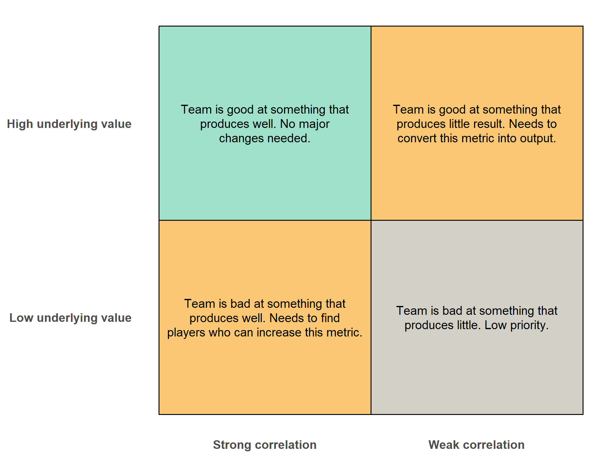

# Correlation Analysis of Various Metrics vs Non-Penalty xG Difference

## by Heechan Han

## Contents
- [Introduction](#introduction)
- [Correlation Data](#correlation-data)
- [Conclusion](#conclusion)

## Introduction
This project is a companion project to my previous project [football-correlation](https://github.com/hhan31415/football-correlation/tree/main). In that project, I computed correlation values between various metrics and points for each league to determine league-wide patterns and determine which metrics best predict success across various leagues. 

This project similarly computes correlation values, this time for specific clubs, to discern which statistic best predicts success for each club. We do this by taking the match statistics for each game a club has played in a season and applying Pearson and Spearman tests, as well as FDR-adjusted p-values, for each metric vs non-Penalty xG difference. We chose nPxG difference as our dependent variable since it is continuous (rather than loss/draw/win) and is a great metric that takes into account overall team performance in offense, defense, and chance creation.

The resulting significant discoveries will give us information about which metric likely correlates with on-field success for each club. For example, if a club has a high positive correlation for crosses, we can reasonably predict that crossing might be the primary successful method that club scores goals and wins matches.

This project will specifically look at the [2025-2026 Premier League Season](data/premier_league_season_2025-2026_stats.csv) and the [2026 MLS season](data/mls_season_2026_stats.csv) up to the World Cup break, although the overall pipeline and analysis can be used for any collection of match data. The match data itself was scraped from my [FotMob data scraper](https://github.com/hhan31415/fotmob-scraper).

## Correlation Data
The correlation computation is done via R in [mls_correlation.R](mls_correlation.R). We first clean up the table and add metrics "non-penalty xG against" and "non-penalty xG difference". We then compute correlation values for each relevant metric against non-penalty xG difference for each club. The data for each club is stored [here](output/club_results/).

Because we are doing a correlation test for each relevant metric and each club in a league, the number of tests done can easily reach over a thousand. Thus, we will perform the Benjamini-Hochberg procedure to control the False Discovery Rate (FDR). We then filter to discoveries significant at FDR < 0.05. This means that among all tests declared significant, the *expected false discovery proportion* - the average share of those discoveries that are false positives, across repeated sampling - is controlled at or below 5%. 

This is a property of the discovery set as a whole, not a per-test guarantee: it does not mean any individual discovery has a 95% probability of reflecting a real relationship, only that the batch of discoveries as a group is expected to contain few false positives. With that caveat, an FDR of 5% still gives reasonable confidence that the bulk of these discoveries reflect genuine relationships rather than artifacts of testing many hypotheses at once.

[This file](output/mls_correlation_significant_results.csv) contains the 85 discoveries significant at FDR < 0.05. We will now analyze this information to point out potential weaknesses and strengths in various clubs that can aid in tactical preparations.

## Analysis
First, why compute correlation and run hypothesis tests instead of simply analyzing the raw data? The reason is that our goal is more than just finding out what metrics clubs put high or low numbers at. The same metric at the same value may account for vastly different match performances. A high number for crosses could be a result of a dominant attacking performance and possession in the final third, but it could also be from a lack of real chance creation leading to desperate crosses. A high number of clearances could be a result of being pushed back and pressed on defense, or it could be a deliberate tactical choice from having strong target men with great hold-up play. 

In either case, the same underlying metric with the same value requires vastly different tactical responses. This is why we calculate correlation against npxG difference. If for some club, a metric shows a strong positive correlation against npxG difference, we can predict that both the offensive and defensive performance of the club tends to increase as the underlying metric increases. On the other hand, a lack of strong correlation may imply that increasing or decreasing that metric has little impact on a team's performance.

### Example 1: Analyzing Chelsea's Offensive Methods
Chelsea especially provides a case where this sort of analysis can be valuable. Let us analyze four main methods a team can create chances: shots inside the box, shots outside the box, crossing, and set play. The following shows a table of relevant metrics and their corresponding correlation data given by our pipeline:
| Stat | Pearson r | Pearson R² | Pearson p | Pearson FDR p | Spearman ρ | Spearman p |
|---|---|---|---|---|---|---|
| npxG per shot | 0.7316 | 0.5353 | 1.80e-07 | 2.53e-05 | 0.5916 | 9.16e-05 |
| Shots inside box | 0.5178 | 0.2681 | 0.0009 | 0.0074 | 0.5267 | 0.0007 |
| Corners | 0.2924 | 0.0855 | 0.0748 | 0.1736 | 0.3776 | 0.0194 |
| xG set play | 0.1760 | 0.0310 | 0.2905 | 0.4405 | 0.2473 | 0.1345 |
| Shots outside box | 0.0757 | 0.0057 | 0.6515 | 0.7762 | 0.1476 | 0.3766 |
| Accurate crosses | 0.0619 | 0.0038 | 0.7122 | 0.8229 | 0.1667 | 0.3173 |
| Accurate crosses % | -0.0532 | 0.0028 | 0.7511 | 0.8431 | -0.0018 | 0.9914 |

First, note that npxG per shot and shots inside the box are both significant metrics and boast a strong correlation with npxG difference. This tells us that Chelsea tend to rely heavily on clear chances inside the box. Furthermore, the lack of correlation and significance for corners, set play, shots outside the box, and crossing further solidifies this point, with many other methods of chance creation being largely ineffective.

I want to emphasize that these results do not *necessarily* mean that Chelsea tend to cross less or shoot less outside the box, but rather, an increase in these metrics often does not really affect overall performance. Tactically, if playing against Chelsea, this means that it is worthwhile to defend more compactly in the box in favor of giving up more crosses and shots outside the box. Defenders should allow for wingers to cross more often and invite players to shoot from distance to give up less space within the box.

The following shows the distribution of each metric above across all of Chelsea's matches, divided by the match result (win, draw, or loss). We can see that the correlation analysis above matches well with the actual results, with metrics like crossing and set pieces having little to no effect on the result of a match.

Let us look at how this analysis can help us in scouting potential players to sign. Consider the following chart:

which shows the relationship between correlation and the underlying value. More simply, we can interpret the underlying value (compared with the rest of the league) as the ability for a club to generate a metric, and the correlation strength as the ability to effectively use a metric.

For Chelsea, its npxG per shot is well above the league average, and its shots in and out of the box are both slightly above the league average. For npxG per shot and shots in the box, this means these metrics are in the top-left quadrant. For shots outside the box, the metric is in the top-right quadrant. Thus, the club should either invest in players with great long-distance ability to better convert the high number of shots outside the box, or the team should change tactically to be more wary of long shots and instead use the space from those opportunities to try and find a way into the box.

Now onto corners and set play xG, Chelsea boasts a much higher corners per game than average and a slightly lower set play xG per game than average. This tells us we are somewhere around the top right and bottom left quadrants in terms of set pieces. The corner count is good, but the actual conversion from corners to xG and xG to match-wide success is a bit lacking. Since the corner generation is already there, an improvement in both the corner taker and receivers can instantly turn a lackluster part of Chelsea's offense into a consistent threat.

Finally, with crossing, Chelsea are below league average for both accurate crosses and accurate crossing %. This places us in the bottom right quadrant. In reality, there's not much reason to deliberately attempt to find success in these metrics. Since Chelsea are already adept at creating chances in the box, there's no reason to inflate either the generation or the conversion of crosses artificially, which might only get in the way of more effective scoring methods. 

### Example 2: Identifying a Major Weakness in Crystal Palace's Defense
We will now show an example where a combination of correlation statistics and raw data values can help us identify certain strengths and weaknesses in a club's playstyle. Let us take Crystal Palace's clearance statistics. Its correlation result gives us r = -0.464 with an FDR p-value of 0.0183, well within the significant range. Thus, we can quite confidently say that Crystal Palace has a moderate negative correlation; i.e., more clearances tend to correlate with a worse npxG difference. 

This does not yet mean that clearances are weak points of Crystal Palace's playstyle. Indeed, if Crystal Palace clearances per game is low, this could point to a strength - that Crystal Palace play well out of pressure without relying on clearances for defense. In fact, this is Arsenal's case to a weaker degree; their correlation for clearances is -0.324 with an FDR-adjusted p-value of 0.12, while they have the 5th-least clearances per game in the league. 

The problem is that Crystal Palace has the *highest* clearances per game in the league at 33.66. Even if we try to account for imbalance in possession by ranking by clearances over possession or clearances over passes in own half, Crystal Palace still ranks first and second, respectively. This is a "bad" version of the top-left quadrant in the previous visual: Crystal Palace relies on clearances more heavily than any other team in the league, and yet also statistically plays the worst when relying on clearances. 

### Example 3: Mid-season Pre-match Analysis - LA Galaxy vs LAFC
Now we will take the 2026 MLS match data and simulate the kinds of pre-match analysis one might perform in preparation for a match. Since the MLS season is ongoing, the data accounts for half of a usual full season's worth of data, which, while giving us much rougher results, better simulates conditions for using this analysis before actual matches. We will take the clubs LA Galaxy and LAFC as the teams to do the analysis.

A major difference between the clubs is shown in their relation to passing statistics, which we can see from the [correlation data](data/mls_season_2026_stats.csv):
| Stat | Team | Pearson r | Pearson R^2 | Pearson p | Pearson FDR p | Spearman ρ | Spearman p |
|---|---|---|---|---|---|---|---|
| Accurate passes | LA Galaxy | 0.6551 | 0.4291 | 0.0080 | 0.0837 | 0.6179 | 0.0163 |
| Accurate passes | Los Angeles FC | -0.0316 | 0.0010 | 0.9110 | 0.9657 | 0.0821 | 0.7728 |
| Accurate passes % | LA Galaxy | 0.5873 | 0.3449 | 0.0213 | 0.1415 | 0.6194 | 0.0138 |
| Accurate passes % | Los Angeles FC | 0.0397 | 0.0016 | 0.8882 | 0.9590 | 0.1048 | 0.7101 |
| Passes | LA Galaxy | 0.6435 | 0.4141 | 0.0096 | 0.0920 | 0.6214 | 0.0156 |
| Passes | Los Angeles FC | -0.0545 | 0.0030 | 0.8470 | 0.9458 | 0.0143 | 0.9642 |

LA Galaxy shows a moderate correlation between the three passing metrics and npxG difference. The FDR-adjusted p-values are a bit higher than we'd like, but for mid-season analysis, they're low enough to make some careful predictions. On the other hand, LAFC shows absolutely no correlation for the three metrics.

Again, it's best to corroborate these with raw stats. The interesting part about both LAFC and LA Galaxy is that their accurate passes and accurate passes % are both roughly the same in the 75th percentile across the MLS. Thus, while both clubs share similar stats in passing, the correlation data tells us that this raw value means different things to each club.

Starting with LA Galaxy, we can look at other metrics with high correlation: 
| stat                             | pearson_r  | pearson_r2  | pearson_p  | spearman_rho | spearman_p  | team_name | pearson_fdr_p |
|----------------------------------|------------|-------------|------------|--------------|-------------|-----------|---------------|
| xG.open.play                     | 0.80578504 | 0.649289538 | 0.00028708 | 0.7          | 0.004876431 | LA Galaxy | 0.012057338   |
| Accurate.passes                  | 0.65507604 | 0.429124617 | 0.00803399 | 0.617857143  | 0.016310268 | LA Galaxy | 0.08365977    |
| Passes                           | 0.64352171 | 0.414120194 | 0.00964045 | 0.621428571  | 0.015571842 | LA Galaxy | 0.09202248    |
| Blocks                           | -0.6112164 | 0.373585534 | 0.01548436 | -0.530838788 | 0.041751435 | LA Galaxy | 0.121181952   |
| Goal.conceded                    | -0.6105296 | 0.372746427 | 0.01563287 | -0.544312816 | 0.035923368 | LA Galaxy | 0.121423367   |
| Accurate.passes   percentage     | 0.58731861 | 0.344943148 | 0.02133104 | 0.619398571  | 0.013797575 | LA Galaxy | 0.141458459   |
| Shots.on.target                  | 0.52403231 | 0.274609862 | 0.04494925 | 0.300205973  | 0.276970885 | LA Galaxy | 0.214530529   |
| Accurate.long.balls   percentage | 0.51170371 | 0.26184069  | 0.05119776 | 0.542857143  | 0.039158555 | LA Galaxy | 0.232047422   |
| Own.half                         | 0.50384665 | 0.25386145  | 0.0554992  | 0.339589054  | 0.215592311 | LA Galaxy | 0.242809021   |
| Opposition.half                  | 0.50078191 | 0.250782522 | 0.05724666 | 0.567857143  | 0.029804473 | LA Galaxy | 0.246249753   |

We must be more cautious with many of these metrics, as their FDR p-values are not significant. Still, it's interesting to note that passing metrics are among the strongest correlations for LA Galaxy. A strong negative correlation for blocks implies a potential weakness against more shots. Interestingly, many attacking metrics like touches in the opposition box, npxG per shot, big chances, and even goals scored present a lower correlation. Comparing this with LAFC's top 10 metrics:

| stat                             | pearson_r  | pearson_r2  | pearson_p  | spearman_rho | spearman_p  | team_name      | pearson_fdr_p |
|----------------------------------|------------|-------------|------------|--------------|-------------|----------------|---------------|
| xG.open.play                     | 0.86134516 | 0.74191548  | 3.70E-05   | 0.788204068  | 0.000481785 | Los Angeles FC | 0.00576641    |
| Shots.inside.box                 | 0.7074844  | 0.500534175 | 0.00317425 | 0.637423964  | 0.010583767 | Los Angeles FC | 0.045971915   |
| Goal.scored                      | 0.66257181 | 0.439001406 | 0.00710975 | 0.523377708  | 0.045266078 | Los Angeles FC | 0.07789817    |
| Big.chances                      | 0.65916158 | 0.434493982 | 0.00751926 | 0.530977347  | 0.041688145 | Los Angeles FC | 0.079615646   |
| npxG_per_shot                    | 0.62799127 | 0.394373036 | 0.01218301 | 0.45         | 0.094351958 | Los Angeles FC | 0.107387741   |
| Tackles                          | -0.5877779 | 0.345482848 | 0.0212048  | -0.61443935  | 0.014801963 | Los Angeles FC | 0.141365315   |
| Touches.in.opposition.box        | 0.58562365 | 0.342955061 | 0.02180189 | 0.500453462  | 0.057436284 | Los Angeles FC | 0.143074934   |
| Successful.dribbles   percentage | 0.51422957 | 0.264432048 | 0.04986849 | 0.596961811  | 0.018798205 | Los Angeles FC | 0.229322254   |
| Shots.on.target                  | 0.44500265 | 0.198027363 | 0.09648349 | 0.349881955  | 0.201107752 | Los Angeles FC | 0.329455822   |
| Total.shots                      | 0.42335914 | 0.179232958 | 0.11585082 | 0.402160232  | 0.137271624 | Los Angeles FC | 0.366083144   |

Which consist of the more commonly expected attacking metrics like big chances and npxG per shot. We also see a much heavier emphasis on shot taking and movement towards and inside the box.

Again, even if the individual metrics themselves may not be significant, these values paint us a good overall picture of the playstyle that works for each club. LA Galaxy's playstyle favors controlling the ball with passes across the field. LAFC's playstyle favors creating as many chances within the box as possible. In general, when doing this sort of analysis, it's important to note that these are not *necessarily* the playstyles that these teams generally use, but rather the playstyles that seem to have found the most success. 

## Conclusion
The above examples are only a number of a variety of interesting discoveries and techniques possible through this analysis. It is a good way of identifying threatening metrics in an opponent and one's own playstyle. It can be used to support pre-match analysis, as well as inform scouting and signing strategy by discovering player profiles that match the strengths and fill in the weaknesses of a given team. 
