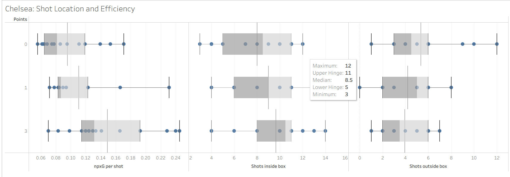
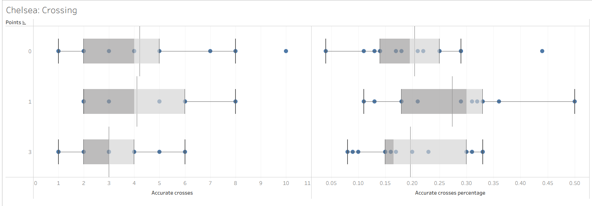
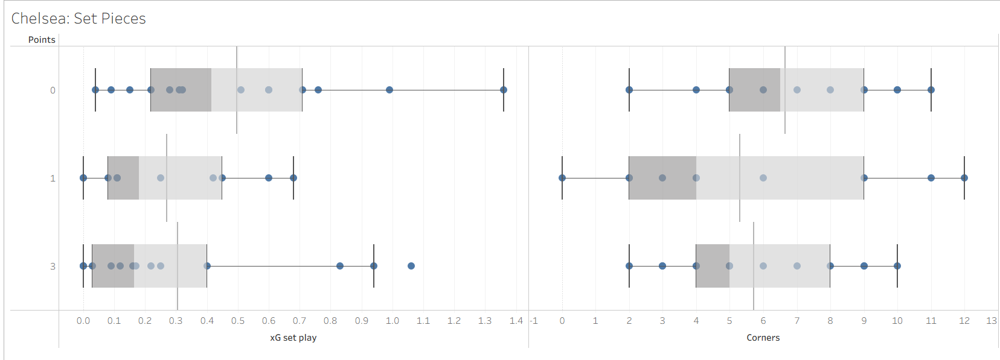

# Correlation Analysis of Various Metrics vs xG Difference for Clubs in the MLS

## by Heechan Han

## Contents
- [Introduction](#introduction)
- [Computing Correlation](#computing-correlation)
- [Comparing Leagues](#comparing-leagues)
- [Interesting Observations](#interesting-observations)
- [Conclusion](#conclusion)

## Introduction
This project is a companion project of my previous project [football-correlation](https://github.com/hhan31415/football-correlation/tree/main). In that project, I computed correlation values between various metrics and points for each league to determine league-wide patterns and determine what metrics best predict success across various leagues. 

This project similarly computes correlation values, this time for specific clubs, to discern which statistic best predicts success for each club. We do this by taking the match statistics for each game a club has played in a season, and applying Pearson and Spearman tests as well as FDR-adjusted p-values for each metric vs non-Penalty xG difference. We chose nPxG difference as our dependent variable since it is continuous (rather than loss/draw/win) and is a great metric that takes into account overall team performance in offense, defense, and chance creation.

The resulting significant discoveries will give us information about which metric likely correlates with on-field success for each club. For example, if a club has high positive correlation for crosses, we can reasonably predict that crossing might the primary successful method that club scores goals and wins matches.

This project will specifically look at the [2025-2026 Premier League Season](data/premier_league_season_2025-2026_stats.csv) [2026 MLS season](data/mls_season_2026_stats.csv) upto the World Cup break, although the overall pipeline and analysis can be used for any collection of match data. The match data itself was scraped from my [FotMob data scraper](https://github.com/hhan31415/fotmob-scraper).

## Correlation Data
The correlation computation is done via R in [mls_correlation.R](mls_correlation.R). We first clean up the table and add metrics "non-penalty xG against" and "non-penalty xG difference". We then compute correlation values for each relevant metric against non-penalty xG difference for each club. The data for each club is stored [here](output/club_results/).

Because we are doing a correlation test for each relevant metric and each club in a league, the number of tests done can easily reach over a thousand. Thus we will perform the Benhamini-Hochberg procedure to control the False Discovery Rate (FDR). We then filter to discoveries significant at FDR < 0.05. This means that among all tests declared significant, the *expected false discovery proportion* - the average share of those discoveries that are false positives, across repeated sampling - is controlled at or below 5%. 

This is a property of the discovery set as a whole, not a per-test guarantee: it does not mean any individual discovery has a 95% probability of reflecting a real relationship, only that the batch of discoveries as a group is expected to contain few false positives. With that caveat, an FDR of 5% still gives reasonable confidence that the bulk of these discoveries reflect genuine relationships rather than artifacts of testing many hypotheses at once.

[This file](output/mls_correlation_significant_results.csv) contains the 85 discoveries significant at FDR < 0.05. We will now analyze this information to point out potential weaknesses and strengths in various clubs which can aid in tactical preparations.

## Analysis
First, why compute correlation and run hypothesis tests instead of simply analyzing the raw data? The reason is that our goal is more than just finding out what metrics clubs put high or low numbers at. The same metric at the same value may account for vastly different match performances. A high number for crosses could be a result of a dominant attacking performance and possession in the final third, but it could also be from a lack of real chance creation leading to desperate crosses. A high number of clearances could be a result of being pushed back and pressed on defense, or it could be a deliberate tactical choice from having strong target men with great hold-up play. 

In either case, the same underlying metric with the same value require vastly different tactical responses. This is why we calculate correlation against npxG difference. If for some club, a metric shows a strong positive correlation against npxG difference, we can predict that both the offensive and defensive performance of the club tends to increase as the underlying metric increases. On the other hand, a lack of strong correlation may imply that increasing or decreasing that metric has little impact on a team's performance.

### Example 1: Analyzing Chelsea's Offensive Methods
Chelsea especially provides a case where this sort of analysis can be valuable. Let us analyze four main methods a team can create chances: shots inside the box, shots outside the box, crossing, and set play. The following shows a table of relevant metrics and their corresponding correlation data given by our pipeline:
| Stat | Pearson r | Pearson R² | Pearson p | Pearson FDR p | Spearman ρ | Spearman p |
|---|---|---|---|---|---|---|
| npxG per shot | 0.7316 | 0.5353 | 1.80e-07 | 2.53e-05 | 0.5916 | 9.16e-05 |
| Shots inside box | 0.5178 | 0.2681 | 0.0009 | 0.0074 | 0.5267 | 0.0007 |
| Corners | 0.2924 | 0.0855 | 0.0748 | 0.1736 | 0.3776 | 0.0194 |
| xG set play | 0.1760 | 0.0310 | 0.2905 | 0.4405 | 0.2473 | 0.1345 |
| Shots outside box | 0.0757 | 0.0057 | 0.6515 | 0.7762 | 0.1476 | 0.3766 |
| Accurate crosses | 0.0619 | 0.0038 | 0.7122 | 0.8229 | 0.1667 | 0.3173 |
| Accurate crosses % | -0.0532 | 0.0028 | 0.7511 | 0.8431 | -0.0018 | 0.9914 |

First, note that npxG per shot and shots inside box are both significant metrics and boast a strong correlation against npxG difference. This tells us that Chelsea tend to rely heavily on clear chances inside the box. Furthermore, the lack of correlation and significance for corners, set play, shots outside the box, and crossing tells us that 

I want to emphasize that these results do not *necessarily* mean that Chelsea tend to cross less or shoot less outside the box, but rather, an increase in these metrics often does not really affect overall performance. Tactically, if playing against Chelsea, this means that it is worthwhile to defend more compactly in the box in favor of giving up more crosses and shots outside the box. Defenders should allow for wingers to cross more often and invite players to shoot from distance to give up less space within the box.

The following shows the distribition of each metric above across all of Chelsea's matches, divided by the match result (win, draw, or loss). We can see that the correlation analysis above matches well with the actual results, with metrics like crossing and set pieces having little to no effect on the result of a match.

### Example 2: Identifying Weaknesses in Crystal Palace's Defense
We will now show an example where a combination of correlation statistics and raw data values can help us identify certain strengths and weaknesses in a club's playstyle. Let us take Crystal Palace's clearance statistics. Its correlation result tells gives us r = -0.464 with a FDR p-value of 0.0183, well within significant range. Thus we can quite confidently say that Crystal Palace has a moderate negative correlation; i.e., more clearances tend to correlate with worse npxG difference. 

This does not yet mean that clearances are weak points of Crystal Palace's playstyle. Indeed, if Crystal Palace clearances per game is low, this could point to a strength - that Crystal Palace play well out of pressure without relying on clearances for defense. In fact, this is Arsenal's case to a weaker degree; their correlation for clearances is -0.324 with FDR-adjusted p-value of 0.12, while they have the 5th least clearances per game in the league. 

The problem is that Crystal Palace has the *highest* clearances per game in the league at 33.66. Even if we try to account for imbalance in possession by ranking by clearances over posession or clearances over passes in own half, Crystal Palace still rank first and second respectively. This means that Crystal Palace relies on clearances more heavily than any other team in the league, and yet also statistically plays the worst when relying on clearances. 

### Example 3:
